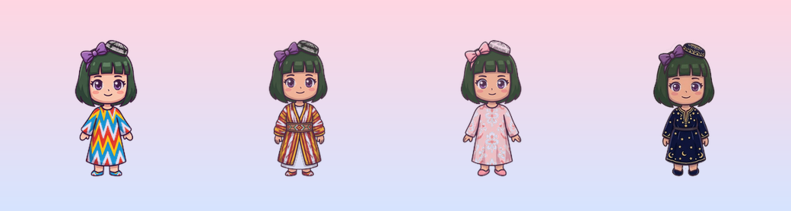
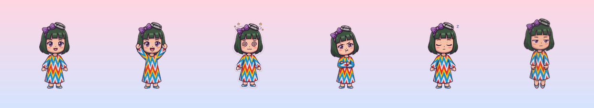
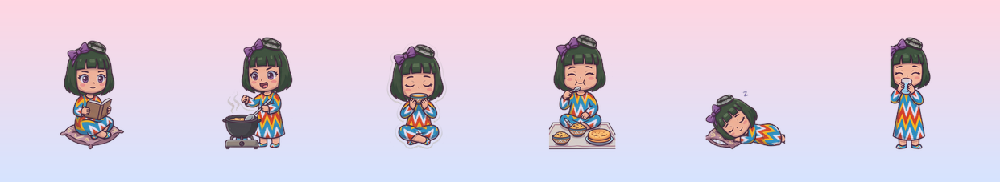
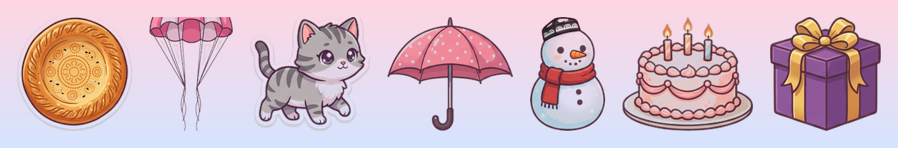
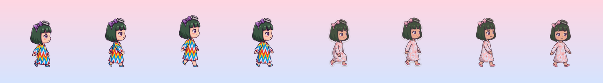

<p align="center">
  
</p>

<h1 align="center">Rayxon</h1>
<p align="center">Mac ish stolida yashaydigan o'zbek chibi qiz — yuradi, gaplashadi, injiqlik qiladi, sog'lig'ingizga qaraydi.</p>

<p align="center">
  
</p>

Rayxon — macOS uchun desktop pet. Shaffof oynada yashaydi, boshqa ilovalar oynalari ustida turadi, oyna yopilsa
parashyut bilan tushadi, oynadan oynaga sakraydi. Gemini / Claude / OpenAI bilan o'zbekcha gaplashadi, o'zbek ovozi
bilan javob beradi, suv ichish va ko'zga dam berishni eslatadi, Pomodoro yuritadi, vazifalarni eslaydi, kayfiyati
bor va o'zi gap boshlaydi.

> Yuklab olish: [Releases](https://github.com/firdavsDev/rayxon/releases) → `Rayxon-x.y.z.dmg`. macOS 15+.

## Nimalar qiladi

<p align="center"></p>

- **Ish stolida jonli**: yuradi, oynalar ustida turadi, oyna yopilsa yiqiladi (balanddan — parashyut), ledge'dan ledge'ga sakraydi,
  balanddan tashlasangiz boshi aylanadi, silkitsangiz xafa bo'ladi, ko'p bossangiz jahli chiqadi.
- **Suhbat**: pufakchada yozasiz (yoki ⌥Space istalgan joydan). Provayder: Gemini, Claude, OpenAI (va OpenAI-mos: Ollama, Groq…).
  Kalitlar Keychain'da. Munosabat rejimi: Do'st / Singil / Sevgili / Ustoz. Sizni eslab qoladi (xotira eksport/import).
- **Ovoz**: Edge TTS orqali bepul o'zbek ovozi (Madina / Sardor). Tugma pufakchaning chap yuqorisida.
- **Kayfiyat**: silasangiz ko'tariladi, unutsangiz tushadi; ohangi o'zgaradi (xafa / injiq / xursand). O'zi gap boshlaydi —
  kalit bo'lsa AI yozadi, bo'lmasa 150+ tayyor ibora.
- **Sog'liq**: suv, ko'z (20-20-20), qomat eslatmalari; Pomodoro; vaqtli vazifalar; kun tartibi (ertalab maqol, kechqurun latifa,
  tungi rejim, 10 daqiqa jim bo'lsangiz "Tirikmisiz?").
- **Ish**: VS Code/Xcode ochilsa reaksiya, Telegram'da 10 daqiqa — piching, git commit'da xursand (loyihalar papkasini ko'rsating).
- **Statistika**: kunlik ish vaqti, pomodoro, suv, suhbat — haftalik grafik.

<p align="center"></p>

- **Mashg'ulotlar**: kitob o'qiydi, palov pishiradi, choy ichadi, dasturxonga o'tiradi, yotib uxlaydi.
- **Hodisalar**: ekran chetiga yashirinib "Bo!" deydi, tez kursorni quvadi, ikki marta bossangiz non tushadi (ushlaydi),
  mushuk Mo'ylov kelib ketadi, yomg'irda soyabon, qorda qor odam, tug'ilgan kuningizda tort va sovg'a.
- **O'yinlar**: tosh-qaychi-qog'oz, "qaysi qo'limda?" — hisob bilan.
- **Tarmoq**: ikki Mac bir Wi-Fi'da bo'lsa Rayxonlar salomlashadi.

<p align="center"></p>

## O'rnatish

1. [Releases](https://github.com/firdavsDev/rayxon/releases) dan DMG ni oching, `Rayxon.app` ni `Applications` ga tashlang.
2. Birinchi marta **o'ng tugma → Open** (Apple notarizatsiyasi hali yo'q).
3. O'ng tugma → **Sozlamalar → Suhbat** → Gemini ([aistudio.google.com](https://aistudio.google.com/apikey), bepul) yoki
   Claude / OpenAI kalitini kiriting. "Modellarni yuklash" joriy modellar ro'yxatini oladi.
4. Ovoz uchun `brew install uv` (edge-tts shu orqali ishga tushadi).

Manbadan: `scripts/run.sh` (debug) yoki `scripts/run.sh --install` (release → /Applications). Swift 6 toolchain kerak, Xcode shart emas.

## Menyu (o'ng tugma yoki menyu bar)
Gaplashish · Uxla / Uyg'ot · Boshini silash · Kursor yoniga chaqirish · Kiyimlar ▸ · Vazifalar · Statistika · O'ynaymizmi? ·
Pomodoro · Sozlamalar · Mac bilan birga yoqish · Yangilanishni tekshirish · Eslab qolganlari · Xotirani tozalash · Yashirish · Chiqish

## Sozlamalar
Umumiy (ism, tug'ilgan kun, ⌥Space, chatter, tungi rejim, tovushlar, kayfiyat) · Qahramon (ism, munosabat, o'lcham, dialog) ·
Suhbat (provayder, kalit, model) · Ovoz (Madina/Sardor, balandlik) · Eslatmalar (suv/ko'z/qomat, Pomodoro) ·
Qiziqarli (ob-havo, ilovalarga reaksiya, git papka, hodisalar, tarmoq)

<p align="center"></p>

## Sprite san'ati
Rasmlar Gemini (Nano Banana) bilan chizilgan, xom varaqlar `art/<kiyim>/` da. Qayta kesish:
```bash
scripts/sprites/build_all.sh   # art/ → Sources/Rayxon/Resources/Sprites/<kiyim>/<holat>.png + manifest.json
```
Katak 256×256 px, oyoq chizig'i y=232. Yangi kiyim: `art/<id>/<id>_idle|walk|happy.jpg` qo'ying, `build_all.sh` ni ishga tushiring,
`SpriteCatalog.outfitTitles` ga nom qo'shing.

## Arxitektura
`Pet/` oyna, animator, fizika, xatti-harakat · `Surfaces/` boshqa oynalarning qirralari (`CGWindowListCopyWindowInfo`, ruxsat kerak emas) ·
`Chat/` provayderlar, persona, kayfiyat, iboralar, xotira · `Voice/` Edge TTS, effektlar · `Wellness/` eslatmalar, Pomodoro, kun tartibi ·
`Fun/` ob-havo, ilova/git kuzatuv, non, mushuk, o'yinlar, tarmoq · `Settings/ Tasks/ Stats/ Bubble/ Menu/` UI.
Ma'lumotlar: `~/Library/Application Support/Rayxon/{memory,tasks,stats}.json`, kalitlar Keychain, sozlamalar UserDefaults.

Testlar: `swift test` (100+). Debug: `RAYXON_DEBUG_EVENT=rain|snow|birthday`, `RAYXON_DEBUG_SAY="..."`, `RAYXON_DEBUG_DROP_Y=800`.

## Tarqatish (release)
```bash
scripts/release.sh 0.2.0                      # test → versiya → DMG → commit + push → GitHub release
scripts/release.sh 0.2.0 "Yangi kiyim, ..."   # o'z izohingiz bilan (aks holda oxirgi tegdan beri commitlar)
```
Standart: ad-hoc imzo. Developer ID + notarizatsiya uchun (bir marta `xcrun notarytool store-credentials rayxon-notary ...`):
`RAYXON_SIGN_IDENTITY="Developer ID Application: Name (TEAMID)" NOTARY_PROFILE=rayxon-notary scripts/release.sh 0.2.0`.
"Yangilanishni tekshirish" GitHub Releases'dan oxirgi versiyani oladi (`UpdateChecker.repo`).

---

<details>
<summary>English</summary>

Rayxon is an Uzbek chibi desktop companion for macOS (Swift 6, AppKit/SwiftUI, SwiftPM). She walks on your desktop,
stands on other apps' windows, falls (with a parachute) when they close, chats in Uzbek via Gemini / Claude / OpenAI,
speaks with a free Uzbek neural voice (Edge TTS), has a mood and relationship modes, reminds you to drink water and
rest your eyes, runs Pomodoro and timed tasks, reacts to the apps you use and your git commits, plays mini-games, and
greets other Rayxons on the LAN. Download the DMG from Releases, right-click → Open the first time, paste an API key in
Settings → Suhbat. `swift test` runs the suite; `scripts/run.sh` builds and launches.
</details>
